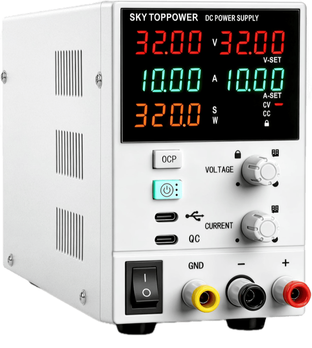

<h1 align="center">SKY TOPPOWER PSU</h1>
<p align="center">
  
  <br>
  <b>PC control panel for the SKY TOPPOWER STP2S bench power supply.</b>
  <br>
  32 V · 10 A · Modbus RTU over USB-C · Electron or WebSerial
</p>
<hr>

SKY TOPPOWER PSU is a control panel for the SKY TOPPOWER STP2S / E22 32 V 10 A
bench supply. It talks Modbus RTU to the unit's USB-C COM port (a CH340 USB
serial chip). You can set voltage and current, switch the output, arm the
protections and watch live readings from your computer.

The same panel runs two ways: as an Electron desktop app that finds the supply
by itself, or in Chrome/Edge over WebSerial. The protocol has been confirmed on
real hardware: reads, writes, output on/off, CV/CC, OCP trip and baud change.

## Protocol / register map

**[docs/PROTOCOL.md](docs/PROTOCOL.md)** is the reference for talking to the
unit: link settings, the Modbus register map, scaling (the decimals register),
FC03/FC06 usage with CRC-checked example frames, known gaps, and what has been
confirmed on hardware. Start there before touching `src/psu/stp2s.js`.

[docs/HARDWARE.md](docs/HARDWARE.md) has the teardown and board notes.

## Highlights

* **Readout split like the real unit:** measured value on the left, setpoint (**V-SET** / **A-SET**) on the right, with sparklines behind the V, A and W digits
* **Voltage presets:** 3.3 / 5 / 9 / 12 / 13.8 / 20 / 24 V, plus V/A steppers
* **Never writes past the unit's own limits:** setpoints are clamped to the max V/A the supply reports
* **OVP / OCP / OPP / OTP status pills** next to CV/CC, with a full-screen overlay when the unit trips
* **Charger mode:** CC/CV charging for Li-ion, LiFePO4 and lead-acid, with a session CSV log
* **Serial trace:** hex + ASCII view of every Modbus frame, labelled with register names, with a "Hide reads" filter
* **Desktop app:** a frameless floating panel that connects as soon as the supply is plugged in

## Hardware

| | |
|---|---|
| Supply | SKY TOPPOWER STP2S / E22, 32 V 10 A |
| Link | USB-C COM port, CH340 (`1a86:7523`) |
| Protocol | Modbus RTU, FC03 reads / FC06 writes, slave 1 |
| Serial | 8N1. The unit ships at 9600; its BPS menu also offers 19200, which the panel uses by default |

Use the COM port (the USB-C marked with the USB symbol), not the QC charging port. A baud change on the front panel
takes effect only after a power cycle with the unit's power switch.

## Desktop app

The desktop app is the main way to run the panel. It's built with
[Electron Forge](https://www.electronforge.io/).

```sh
npm install
make app        # build the CSS, then launch the app (same as `make` / `npm start`)
make app-dev    # same, with live reload: Sass watch + window reload on any src/ change
make package    # build the .app into out/
make dist       # zip + dmg installers into out/make/
```

There's no port picker. The app waits for the CH340 and connects when it's
plugged in.

* **Frameless, floating panel.** Only the panel shows. The window sizes itself to the content, follows zoom (Cmd +/-), stays on screen and remembers its position between launches.
* **Serial trace in its own window.** When the trace is on, it opens as a separate, normal window.
* **Dev name fix.** `make app-dev` renames the dev Electron bundle to `productName`, so the macOS menu bar says "SKY TOPPOWER PSU" instead of "Electron".

## Browser

The same panel runs in Chrome or Edge over WebSerial, with a Connect button and
the browser's port picker.

```sh
make serve    # build the CSS once and serve src/ on http://localhost:8150
make dev      # same, but recompile styles.scss on save (reload the browser after edits)
```

* `?baud=9600&slave=1` overrides the serial settings
* `?trace=1` starts the serial trace on, `?debug=1` turns on console debug logging (both are also under Settings → Debug)
* `/diag.html` is a minimal diagnostics page with a write-enable checkbox and the lock/beep/NO/OVP/OCP/OPP switches

## Charger mode

Switch the panel to charger mode and the preset row becomes a chemistry/profile
picker. The OUTPUT button becomes **START / ABORT CHARGE**.

The charge state machine runs in the panel, not on the supply. It steps through
precharge, CC, CV and float. CV ends when the current tapers off, and the
charge faults and turns the output off if it runs past its time limit.

| Chemistry | Absorb (per cell) | Float (per cell) | Precharge below |
|---|---|---|---|
| Li-ion / LiPo | 4.20 V | — | 3.0 V |
| LiFePO4 | 3.65 V | 3.40 V | 2.5 V |
| Lead-acid / AGM | 2.40 V | 2.25 V | — |

From cell count, capacity and charge current, the Derived view works out
absorb/float voltage, charge current, taper current, max watts and estimated
average watts. Absorb is capped at the OVP limit or the supply's 32 V max, and
the panel tells you when that happens. Every session can be downloaded as a CSV
log.

> [!WARNING]
> Charger mode passes its tests and has been checked in the running app, but
> it hasn't been through a real charge yet. Watch the first one, and use a pack
> you can afford to lose.

## Protection

* The OVP/OCP/OPP pills show grey when off, blue when armed and blinking red when tripped. Hover a pill to see its state and limit.
* OVP and OCP limits and the OVP/OCP/OPP enable switches can be set from the panel. OPP is read-only here because it's a 32-bit register that FC06 can't write. Set it on the front panel.
* While OVP is armed, the panel refuses a voltage setpoint above OVP, an OVP limit below the setpoint, and turning OVP on while the setpoint is above it.

> [!IMPORTANT]
> An OVP or OTP trip latches on the supply until you power-cycle it. The panel
> blocks itself with a full-screen overlay until a fresh read shows the flag
> clear.

## Tests

```sh
npm test    # node:test, no hardware needed
```

The tests cover CRCs against the vendor's example frames, framing and timeouts,
register scaling, the panel controller, the panel bridge, the serial trace and
the charge profiles. They run against a fake device that enforces the vendor's
limits.

[docs/VALIDATION.md](docs/VALIDATION.md) lists what has been checked on
hardware and what still needs a bench pass.

## Project layout

| Path | What it is |
|---|---|
| `src/modbus/` | Modbus RTU: CRC, FC03/FC06 frames, a serialized request/response client |
| `src/psu/base.js` | `ModbusPSU`: register-map-driven read/write/scaling and grouped polling |
| `src/psu/stp2s.js` | `STP2S`: the register map. A new model is a new subclass. |
| `src/transport/` | Transport interface, WebSerial, loopback, and `tap.js` for the serial trace |
| `src/ui/` | DOM-free panel controller, panel bridge, debug flags and serial trace UI |
| `src/charge/` | Charge profiles and state machine |
| `src/index.html`, `src/backend.js` | The panel and its WebSerial backend. `styles.css` is built from `styles.scss`. |
| `main.js`, `preload.js`, `forge.config.js` | Electron main process, preload and Forge build config |
| `tests/` | `node:test` suites |

## Credits

The panel UI is adapted from a shared bench-supply panel. The transport layer
was carried over from the dps150 project.

## License

MIT, see [LICENSE](LICENSE). Made by Rob Vella ([@rgr4y](https://github.com/rgr4y)).

---
> This is a personal project and is not affiliated with or endorsed by SKY
> TOPPOWER. All product names and trademarks belong to their owners.
